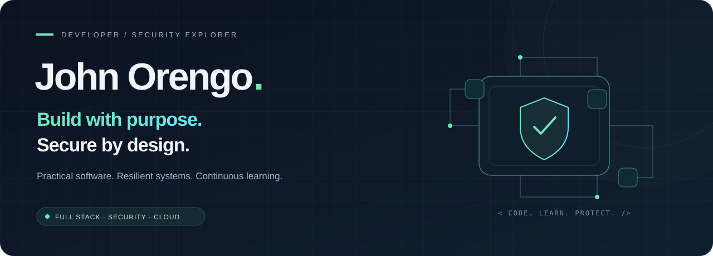

<p align="center">
  
</p>

<p align="center">
  <a href="https://github.com/johnorengo?tab=repositories"></a>
  <a href="https://www.linkedin.com/in/johnorengo/"></a>
  <a href="mailto:orengokennedy93@gmail.com"></a>
</p>

## A little about me

I'm **John**, a Computer Science graduate and full stack developer who enjoys turning real world problems into useful software. I care about how an application works, how it feels to use, and how well it protects the people who rely on it.

My work and learning sit at the intersection of **software engineering, cybersecurity, and cloud infrastructure**. From Laravel applications to Python security utilities, I build to understand and keep improving what I understand.

<table>
<tr>
<td width="33%" valign="top">

### 01 / Build
Web and mobile applications with clear workflows, maintainable code, and practical value.

**Laravel · Flutter · JavaScript**

</td>
<td width="33%" valign="top">

### 02 / Protect
Exploring offensive and defensive security, digital forensics, and network analysis.

**Linux · Wireshark · CTFs**

</td>
<td width="33%" valign="top">

### 03 / Scale
Learning how to deploy and secure reliable systems in the cloud.

**AWS · Cloud security · DevOps**

</td>
</tr>
</table>

## Selected work / Real world impact

Business websites, security tools, and education platforms. Explore the work featured on **[my portfolio ↗](https://john4tech.vercel.app/#projects)**.

<table>
<tr>
<td colspan="2" valign="top">

**SPOTLIGHT / DEVELOPER SECURITY**

### SecretGuard · Catch secrets before they ship

A Python CLI that scans repositories for potentially exposed API keys, tokens, and passwords. Findings include file locations, severity, and remediation guidance, with optional JSON reports and masked matched values.

```text
Source repository  →  Detection rules  →  Prioritized findings  →  Remediation
```

`Python` `Secret detection` `JSON reporting`

**[Explore the source →](https://github.com/johnorengo/SecretGuard)**

</td>
</tr>
<tr>
<td width="50%" valign="top">

<a href="https://sebbylogistics.com/"></a>

**01 / COMMERCE & LOGISTICS**

### Sebby Logistics Ltd
Connecting international flower buyers with Kenyan growers and airfreight services through JKIA. Sourcing, quality assurance, and export information guide visitors toward detailed quotation enquiries.

`Quotation enquiries` `WhatsApp` `SEO`

**[Visit the live site ↗](https://sebbylogistics.com/)**

</td>
<td width="50%" valign="top">

<a href="https://citymartelectricals.com/"></a>

**02 / DIGITAL SHOWROOM**

### Citymart Electricals
A digital showroom for a Kisumu electrical and hardware supplier. Searchable products, installation galleries, and service information help customers find solutions and request quotations.

`Product catalog` `Quotations` `Installation gallery`

**[Visit the live site ↗](https://citymartelectricals.com/)**

</td>
</tr>
<tr>
<td width="50%" valign="top">

**03 / TECHNOLOGY & SERVICES**

### Fox Tech Solutions
A business website bringing software development, design, marketing, and IT support services together. Interactive case studies and delivery guidance help prospective clients explore the work and start a conversation.

`Service showcase` `Interactive case studies` `Client enquiries`

**[Visit the live site ↗](https://foxtechsolution.com/)**

</td>
<td width="50%" valign="top">

**04 / SECURITY AWARENESS**

### Password Strength Checker
An interactive Python utility that turns password length and character checks into clear **Weak / Moderate / Strong** feedback. A focused exploration of regular expressions and password hygiene.

`Python` `Regular expressions` `Input validation`

**[Explore the source →](https://github.com/johnorengo/Python_Password_Checker)**

</td>
</tr>
<tr>
<td width="50%" valign="top">

<a href="https://dataverifications.education.go.ke/"></a>

**05 / EDUCATION & DATA**

### School Data Verification System
A Ministry of Education platform for verifying enrolment records and identifying inaccurate learner entries. Separate access for institution heads and education directors supports verification and oversight.

`Record verification` `Role based access`

**[Explore the platform ↗](https://dataverifications.education.go.ke/)**

</td>
<td width="50%" valign="top">

<a href="https://kplp.education.go.ke/"></a>

**06 / SCHOOL SAFETY**

### Education Emergency Management System
A school safety platform supporting preparedness and emergency response across Kenya's 47 counties. Risk profiles, incident reporting, and safeguarding workflows support student welfare and learning continuity.

`Risk monitoring` `Incident reporting` `Safeguarding`

**[Explore the platform ↗](https://kplp.education.go.ke/)**

</td>
</tr>
</table>

<p align="center">
  <a href="https://john4tech.vercel.app/#projects"></a>
  <a href="https://github.com/johnorengo?tab=repositories"></a>
</p>


## My toolkit

**Application development**


**Data & developer tools**


**Cloud, infrastructure & security interests**

`AWS` `Azure` `Linux` `Docker` `Kubernetes` `Wireshark` `Parrot OS` `Network security`

## Currently exploring

- **Secure applications:** building reliable software with security and maintainability in mind.
- **Cloud foundations:** deepening practical knowledge of infrastructure, IAM, and cloud security.
- **Security practice:** learning through CTF challenges, network analysis, and digital forensics.
- **Collaboration:** contributing consistently and turning ideas into useful applications.

## Let's build something meaningful

I enjoy connecting with developers, security practitioners, cloud engineers, and people solving interesting problems.

**[LinkedIn](https://www.linkedin.com/in/johnorengo/)** &nbsp; / &nbsp; **[Email](mailto:orengokennedy93@gmail.com)** &nbsp; / &nbsp; **[GitHub](https://github.com/johnorengo)**

---

<p align="center">
  <sub><strong>Keep building. Keep learning. Make every contribution count.</strong></sub>
</p>
