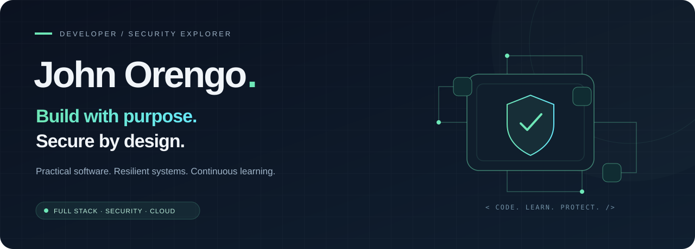

  

  
  
  

## About me

I'm John Orengo, a Computer Science graduate and full stack developer. I build web applications and business websites, and develop Python tools as part of my interest in cybersecurity.

I work with Laravel, PHP, JavaScript, and Flutter. My ongoing learning focuses on cloud infrastructure, network security, and digital forensics. I value clear interfaces, maintainable code, and practical solutions to everyday problems.

<table>
<tr>
<td width="33%" valign="top">

### Development
Web and mobile applications with clear workflows, maintainable code, and practical value.

**Laravel · Flutter · JavaScript**

</td>
<td width="33%" valign="top">

### Security interests
Exploring offensive and defensive security, digital forensics, and network analysis.

**Linux · Wireshark · CTFs**

</td>
<td width="33%" valign="top">

### Cloud learning
Learning how to deploy and secure reliable systems in the cloud.

**AWS · Cloud security · DevOps**

</td>
</tr>
</table>

## Technologies

**Application development**

**Data & developer tools**

**Cloud, infrastructure & security interests**

`AWS` `Azure` `Linux` `Docker` `Kubernetes` `Wireshark` `Parrot OS` `Network security`

## Current focus

I'm continuing to develop my skills in secure application development, AWS infrastructure and IAM, and network analysis through practical projects and security labs.

## Contact

For project enquiries or professional connections, reach me through LinkedIn or email.

**[LinkedIn](https://www.linkedin.com/in/johnorengo/)** &nbsp; / &nbsp; **[Email](mailto:orengokennedy93@gmail.com)** &nbsp; / &nbsp; **[GitHub](https://github.com/johnorengo)**
